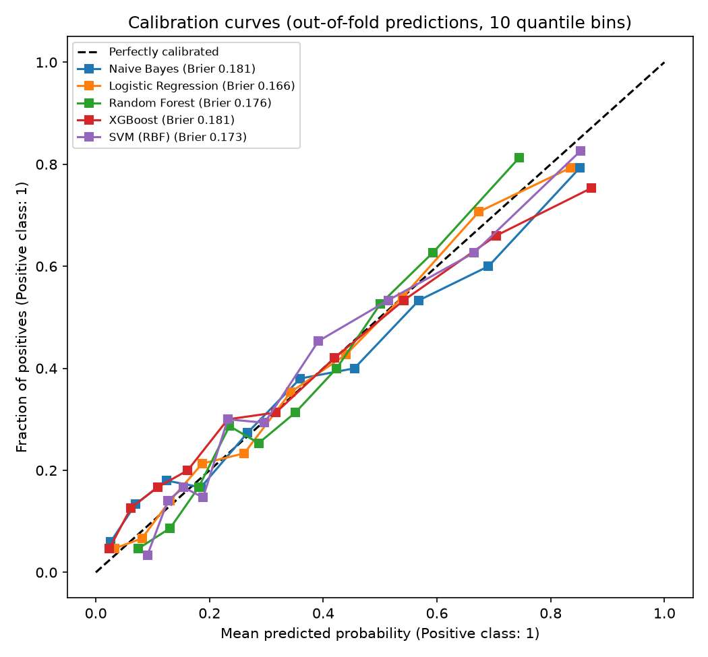
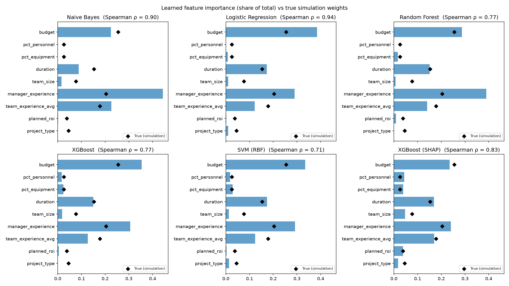

# Predicting Project Success Before It Starts: A Machine Learning Comparison

> Estimating the probability that a project will succeed using only information available *before* it starts, and comparing 5 machine learning models against a known ground truth.

## Overview

Project evaluation is typically taught and applied through formula-based methods. This project explores a machine learning alternative: given a project's characteristics at the planning stage (budget, duration, team, manager experience, project type...), estimate its probability of success, so that resources are not committed to projects unlikely to deliver.

Two design choices:

- **No data leakage:** only features known before the project starts are used (including the *planned* ROI from the business case, not the realised one).
- **Simulated data with a known ground truth:** real project data with outcomes is hard to obtain. Simulating the data lets me check whether the models recover the true drivers of success.

## Data

1,500 simulated projects, ~35% successes. Variables:

| Variable | Description |
|---|---|
| `budget` | Project budget (k EUR) |
| `pct_personnel`, `pct_equipment` | Budget shares (0-1, sum ≤ 1) |
| `duration` | Planned duration (months) |
| `team_size` | Number of team members |
| `manager_experience` | Project manager experience (years) |
| `team_experience_avg` | Average team experience (years) |
| `planned_roi` | ROI planned in the business case (%) |
| `project_type` | Tech/IT, Operations, Marketing & Sales, HR/Organizational, R&D/Product development |
| `success` | Target: 1 = success, 0 = failure |

The simulation includes correlations between variables (e.g. budget with team size), an inverted-U effect of team size, an interaction between long duration and low manager experience, and a latent noise term, so no model can reach 100%. The true weights are documented in `src/simulated_data.py`.

## Approach

- **Models:** Naive Bayes, Logistic Regression, Random Forest, XGBoost, SVM (RBF kernel, calibrated probabilities)
- **Preprocessing:** scikit-learn Pipelines (scaling + one-hot encoding for Logistic Regression and SVM; one-hot only for tree models and Naive Bayes)
- **Validation:** stratified 80/20 train/test split; stratified 5-fold cross-validation on the training set only; test set used once
- **Metrics:** ROC-AUC, PR-AUC, F1, accuracy, confusion matrix
- **Calibration:** Brier score and calibration curves
- **Interpretability:** permutation importance for all models and SHAP for XGBoost, compared with the true simulation weights
- **Reference points:** a constant baseline and an *oracle* that uses the true probabilities (theoretical ceiling)

## Results

Test set: 300 projects. F1 and accuracy use a fixed 0.5 threshold.

| Model | CV ROC-AUC | Test ROC-AUC | PR-AUC | F1 | Accuracy | Brier |
|---|---|---|---|---|---|---|
| Naive Bayes | 0.780 ± 0.019 | 0.780 | 0.697 | 0.614 | 0.757 | 0.175 |
| Logistic Regression | 0.810 ± 0.017 | 0.823 | 0.748 | 0.649 | 0.777 | 0.158 |
| Random Forest | 0.783 ± 0.025 | 0.813 | 0.710 | 0.621 | 0.777 | 0.168 |
| XGBoost | 0.777 ± 0.017 | 0.802 | 0.704 | 0.611 | 0.750 | 0.173 |
| SVM (RBF) | 0.795 ± 0.019 | 0.811 | 0.716 | 0.593 | 0.753 | 0.166 |
| *Baseline (constant)* | - | 0.500 | 0.353 | 0.000 | 0.647 | 0.228 |
| *Oracle (true probabilities)* | - | 0.857 | 0.772 | 0.677 | 0.783 | 0.145 |





## Key findings

- All five models clearly beat the baseline (ROC-AUC 0.78-0.82 vs 0.50) and stay below the oracle (0.857), as expected given the latent noise in the simulation.
- **Logistic Regression is the best model on the test set**, but the gaps between models are within the cross-validation spread (about ±0.02), so there is no clear winner. A plausible reason: the true process is mostly linear on the logit scale, leaving little extra signal for flexible models.
- Logistic Regression **recovers the large true weights almost exactly** (budget 0.97 vs 1.0, manager experience 0.80 vs 0.80, duration -0.60 vs -0.60).
- **Naive Bayes over-weights manager experience**: it treats correlated predictors (manager and team experience) as independent.
- Small effects (planned ROI, project type, budget shares, team size) are not recovered by any model: with 1,500 projects they are too weak to separate from noise.

## Limitations

- **Simulated data:** results show how methods behave when the generating process is known, not how they would perform on real project portfolios.
- **Single dataset, seed and split:** rankings between close models are not robust; no repetition over multiple simulations.
- **No hyperparameter tuning** and a fixed 0.5 decision threshold.
- **Non-linear effects** (inverted-U team size, duration × manager experience interaction) are too small to be learned reliably.
- Permutation importance, SHAP and true logit weights have different units: only ranks and relative sizes are compared.

## What this project demonstrates

- Simulating data with a controlled, documented ground truth
- Building leakage-free ML pipelines with mixed numeric and categorical features
- Comparing models with cross-validation, probabilistic metrics and calibration analysis
- Interpreting models (permutation importance, SHAP) and checking them against the truth
- Reporting results and limitations honestly

## Repository structure

```
data/          simulated_data.csv
src/           simulated_data.py, models.py, evaluation.py
notebooks/     analysis.ipynb (EDA, model comparison, feature importance, conclusions)
reports/       figures and result tables produced by src/evaluation.py
```

## How to run

```bash
pip install -r requirements.txt
python src/simulated_data.py     # generates data/simulated_data.csv
python src/evaluation.py         # trains, evaluates, saves figures and tables to reports/
```

Then open `notebooks/analysis.ipynb` for the full analysis.

## Author

Tommaso Cecchellero · [LinkedIn](https://www.linkedin.com/in/tommaso-cecchellero-74b1ba298)
